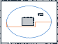

# 室内移动机器人二维激光 SLAM 与路径规划

机器人沿室内环线采集二维激光扫描。程序用带偏差的里程计预测位姿，再将当前扫描与已有占据栅格匹配，在更新后的地图上规划一条连接环线两侧的路线。这个实验可作为移动机器人建图与导航大创项目的 Python 仿真基线。



## 运行

使用 Python 3.9 或更高版本，在项目目录执行以下命令。程序仅使用标准库。

```bash
python demo.py --seed 7 --out results
```

用浏览器打开 `results/map.svg`。深色格子表示障碍物，白色表示已观测的自由空间，灰色表示未知或证据相抵。蓝线是建图时的估计轨迹，橙线是 A* 在最终地图上计算的路径。`trajectory.csv` 每行对应一帧，包含真值、里程计和 SLAM 位姿，位置单位为米，航向单位为弧度。`metrics.json` 记录误差及规划结果。

## 实验设计

场景为 12 m × 9 m 的房间，内有两个矩形障碍物。每帧包含 90 束激光，最大量程 10 m，地图分辨率 0.15 m。仿真器对激光距离和里程计加噪，并引入里程计系统偏差。算法与真值共享初始位姿，之后只使用相邻帧的里程计增量和当前扫描估计位姿。场景几何仅供仿真器产生观测。

1. 在里程计预测附近枚举平移和航向修正，按激光端点与已有障碍栅格的重合程度打分。
2. 将校正后的激光射线投影至地图，沿途累积自由空间证据，命中端点累积障碍证据。
3. 在已知自由空间内做四邻域 A* 搜索，要求路径格周围一圈均为空闲。规划起点和终点分别取第 0 和第 80 帧的估计位置。

## 可复现实验结果

种子 7 共生成 161 帧。以同一初始坐标系中的仿真真值计算二维位置 RMSE，纯里程计为 **0.655 m**，扫描匹配后为 **0.104 m**。规划路径长 **11.85 m**。可更换 `--seed` 比较噪声变化的影响。[示例指标](example/metrics.json)

实验范围为单场景离线仿真、局部扫描匹配与全局路径规划。闭环位姿图优化、运动控制、ROS 接入以及与 Cartographer、RTAB-Map 的同数据对比仍待实现。
